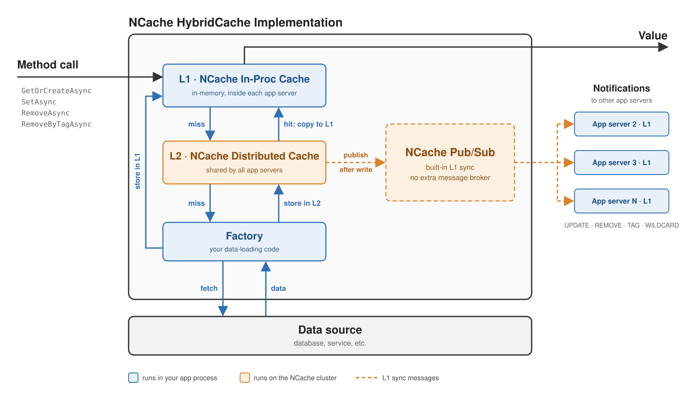

# ASP.NET Core HybridCache by NCache

[](https://www.nuget.org/packages/NCache.OSS.Caching.Hybrid)
[](https://www.nuget.org/packages/NCache.OSS.Caching.Hybrid)
[](https://dotnet.microsoft.com/)
[](LICENSE)

A native implementation of Microsoft's [`HybridCache`](https://learn.microsoft.com/aspnet/core/performance/caching/hybrid) for ASP.NET Core and .NET 8+ apps that keeps every server's in-process (L1) cache in sync, using NCache Pub/Sub.

Use the same `HybridCache` API you already know. Swap in one registration call, and cache updates and invalidations reach every app server, with no separate message broker to run.

---

## Contents

- [Why this exists](#limitations-of-microsoft-hybridcache)
- [Key features](#key-features)
- [How it works](#how-it-works)
- [Choosing an integration model](#choosing-an-integration-model)
- [NCache Open Source vs. Enterprise](#ncache-open-source-vs-enterprise)
- [Prerequisites](#prerequisites)
- [Getting started](#getting-started)
- [Configuration reference](#configuration-reference)
- [Usage examples](#usage-examples)
- [Sample app](#sample-app)
- [Limitations and behavior notes](#limitations-and-behavior-notes)
- [Troubleshooting](#troubleshooting)
- [FAQ](#faq)
- [Resources](#resources)
- [Support](#support)
- [Contributing](#contributing)
- [License](#license)

---

## Limitations of Microsoft HybridCache

`HybridCache` combines a fast in-process cache (L1) with a shared distributed cache (L2). Microsoft's default implementation, however, has these critical gaps when your app runs on more than one server:

- **L1 cache updates do not synchronize with other clients.** If one client updates its L1 cache, the other clients are unaware of it. This includes removing a key or tag as well. Other clients' L1 caches keep serving stale data until their local entry expires.

Both behaviors are documented in Microsoft's [HybridCache guidance](https://learn.microsoft.com/aspnet/core/performance/caching/hybrid).

NCache implementation closes those gaps by first updating the L2 clusetred cache and then using the NCache Pub/Sub to notify all other NCache clients (app servers) of changes.

## Key features

- **Cross-server L1 sync.** `SetAsync`, `RemoveAsync`, and `RemoveByTagAsync` are broadcast to every app server through NCache Pub/Sub. No separate message broker is needed.
- **Cluster-wide tag invalidation.** `RemoveByTagAsync` (including the `"*"` wildcard) applies on every server and survives restarts, because invalidation timestamps are stored in L2.
- **Bulk operations.** Removing many keys or tags is sent as one L1/L2 operation and one Pub/Sub message.
- **Stampede protection.** Concurrent requests for the same missing key on a node share a single factory call.
- **Per-call control.** Full support for `HybridCacheEntryFlags` to skip L1 or L2 reads or writes on a given call.
- **Drop-in replacement.** Your code keeps using the standard `HybridCache` API. Only the registration changes.

## How it works



**Read path.** `GetOrCreateAsync` checks L1, then L2. On a miss in both, your factory loads the data, and the result is stored in L2 and L1.

**Write path.** Writes go to L2, then a message is published to NCache Pub/Sub, then L1 is updated. Every other app server receives the message and updates its own L1.

| Operation | Message published | What other app servers do |
|---|---|---|
| `SetAsync` | `UPDATE` | Refresh the key in L1 |
| `RemoveAsync` (single or bulk) | `REMOVE` | Evict the key(s) from L1 |
| `RemoveByTagAsync(tag)` | `TAG` | Treat L1 entries with that tag created before the invalidation as stale |
| `RemoveByTagAsync("*")` | `WILDCARD` | Treat all L1 entries created before the invalidation as stale |

<!-- TODO: confirm with engineering whether REMOVE/UPDATE refresh or evict the remote L1 entry -->

**Tag invalidation.** Tags are invalidated logically, not deleted. The invalidation time is stored in L2 as a sentinel key, or for the wildcard and broadcast to all servers. On the next read, any entry created before that time is treated as a miss and reloaded through the factory.

## Choosing an integration model

NCache supports `HybridCache` in two ways:

| | Microsoft's HybridCache + NCache as L2 | NCache HybridCache (this package) |
|---|---|---|
| Package | [`NCache.Microsoft.Extensions.Caching.Opensource`](https://www.nuget.org/packages/NCache.Microsoft.Extensions.Caching.Opensource) | [`NCache.OSS.Caching.Hybrid`](https://www.nuget.org/packages/NCache.OSS.Caching.Hybrid) |
| L1 | Microsoft `MemoryCache` | NCache In-Proc local cache |
| L2 | NCache via `IDistributedCache` | NCache distributed cache |
| L1 sync across servers | No | Yes, through NCache Pub/Sub |
| Tag invalidation across servers | No (local server and L2 only) | Yes |
| Registration | `AddHybridCache()` + NCache `IDistributedCache` | `AddNCacheHybridCache()` |

Choose **this package** if your app runs on more than one server and stale L1 data is a problem. Choose **NCache as L2** if you want to stay on Microsoft's implementation and only need a shared distributed tier.

See the [NCache HybridCache documentation](https://www.alachisoft.com/resources/docs/ncache/prog-guide/hybrid-cache.html) for both models.

## NCache Open Source vs. Enterprise

This repository is the **NCache Open Source** implementation. A HybridCache implementation for [**NCache Enterprise**](https://www.alachisoft.com/ncache/) is coming soon..

The main difference is how the L1 caches on your app servers are kept in sync:

- **Open Source** keeps L1 caches in sync by having the implementation publish a message to NCache Pub/Sub on every change. Each app server receives the message and updates its own L1.
- **Enterprise** uses NCache's highly optimized [**Client Cache**](https://www.alachisoft.com/ncache/ncache-architecture.html#nc-client-cache) feature as L1. Each app server's Client Cache is kept in sync with the cluster by NCache itself, so the HybridCache implementation does not need to send sync messages at all.

| | NCache Open Source | NCache Enterprise |
|---|---|---|
| L1 | NCache In-Proc cache | NCache Client Cache |
| L2 | NCache distributed cache | NCache distributed cache |
| How L1 caches stay in sync | Pub/Sub messages sent by the HybridCache implementation | Client Cache sync handled by NCache itself |
| HybridCache API | Standard `HybridCache` | Standard `HybridCache` |
| Availability | Available now: [`NCache.OSS.Caching.Hybrid`](https://www.nuget.org/packages/NCache.OSS.Caching.Hybrid) | Coming soon |

<!-- TODO: add Enterprise package name, docs link, and release date when available -->

> [!NOTE]
> Both implementations use the same `HybridCache` API, so code written against the Open Source implementation will run on NCache Enterprise with a change of registration and configuration only.

<!-- TODO: confirm the note above (same API; only registration/config changes when moving to Enterprise) -->

## Prerequisites

- **.NET 8.0 or later** (.NET 9 and .NET 10 are supported).
- **NCache Open Source 5.3.603 or later** installed on your cache servers, with the L2 distributed cache created and running.
- **An In-Proc L1 cache** defined in `config.ncconf`. NCache installs one named `defaultLocalCache`.
- **Network access** from each app server to the NCache servers (default port `9800`).

Client machines only need the NuGet package. NCache does not have to be installed on them.

## Getting started

### 1. Install the package

```shell
dotnet add package NCache.OSS.Caching.Hybrid
```

Or, in the Package Manager Console:

```powershell
Install-Package NCache.OSS.Caching.Hybrid
```

Installing the package adds `client.ncconf` and `config.ncconf` to your project. These files are copied to your output folder.

### 2. Check the `.ncconf` files

- **`client.ncconf`** lists the NCache servers and the caches your app connects to.
- **`config.ncconf`** defines the In-Proc L1 cache.

NCache reads these files from your app's folder first, then from the NCache install folder. If NCache is not installed on the app server, make sure the local `config.ncconf` defines an In-Proc cache whose name matches `LocalCacheName`.

### 3. Add configuration to `appsettings.json`

```json
{
  "NCacheHybridCache": {
    "LocalCacheName": "defaultLocalCache",
    "LocalCacheExpiration": "00:05:00",
    "DistributedCacheName": "defaultCache",
    "DistributedCacheExpiration": "01:00:00",
    "ServerList": [
      { "Ip": "192.168.1.100", "Port": 9800 }
    ]
  }
}
```

<!-- TODO: GitHub README used section name "NCacheHybridCacheConfiguration"; NuGet README uses "NCacheHybridCache". Confirm the correct name. -->

### 4. Register the implementation in `Program.cs`

```csharp
using NCache.OSS.Caching.Hybrid;

var builder = WebApplication.CreateBuilder(args);

builder.Services.AddNCacheHybridCache(
    builder.Configuration.GetSection("NCacheHybridCache"));

var app = builder.Build();
```

### 5. Use `HybridCache` in your code

```csharp
using Microsoft.Extensions.Caching.Hybrid;

public class ProductService(HybridCache cache, IProductRepository repository)
{
    public async Task<Product> GetProductAsync(int id, CancellationToken ct = default)
    {
        return await cache.GetOrCreateAsync(
            $"product:{id}",
            async cancel => await repository.GetByIdAsync(id, cancel),
            new HybridCacheEntryOptions
            {
                Expiration = TimeSpan.FromMinutes(30),          // L2
                LocalCacheExpiration = TimeSpan.FromMinutes(5)  // L1
            },
            tags: ["products"],
            cancellationToken: ct);
    }

    public async Task UpdateProductAsync(Product product, CancellationToken ct = default)
    {
        await repository.SaveAsync(product, ct);

        // Removed from L2 and from L1 on every app server
        await cache.RemoveAsync($"product:{product.Id}", ct);
    }
}
```

That's it. Run your app on two or more servers, and an update on one server reaches the L1 cache on all of them.

## Configuration reference

### `NCacheHybridCache` settings

| Setting | Required | Default | Description |
|---|---|---|---|
| `LocalCacheName` | Yes | — | Name of the NCache In-Proc cache used as L1 |
| `LocalCacheExpiration` | No | — | Default L1 lifetime. Overridden per call by `HybridCacheEntryOptions.LocalCacheExpiration` |
| `DistributedCacheName` | Yes | — | Name of the NCache distributed cache used as L2 |
| `DistributedCacheExpiration` | No | — | Default L2 lifetime. Overridden per call by `HybridCacheEntryOptions.Expiration` |
| `ServerList` | Yes | — | NCache server nodes for L2. Each entry has `Ip` and `Port` (default `9800`) |
| `EnableLogs` | No | `false` | Turns on diagnostic logging |

<!-- TODO: confirm defaults for the expiration settings and whether EnableLogs is still supported in 5.3.603 -->

### Configure in code

Instead of `appsettings.json`, you can set options directly:

```csharp
builder.Services.AddNCacheHybridCache(options =>
{
    options.LocalCacheName = "defaultLocalCache";
    options.DistributedCacheName = "defaultCache";
    options.ServerList =
    [
        new ServerConfig { Ip = "192.168.1.100", Port = 9800 }
    ];
});
```

### Per-call options

`HybridCacheEntryOptions` overrides the defaults for a single call:

| Property | Description |
|---|---|
| `Expiration` | L2 lifetime |
| `LocalCacheExpiration` | L1 lifetime |
| `Flags` | `HybridCacheEntryFlags` that change how this call uses each tier |

Supported flags:

| Flag | Effect |
|---|---|
| `None` | Read and write both L1 and L2 (default) |
| `DisableLocalCacheRead` / `DisableLocalCacheWrite` / `DisableLocalCache` | Skip L1 reads, writes, or both |
| `DisableDistributedCacheRead` / `DisableDistributedCacheWrite` / `DisableDistributedCache` | Skip L2 reads, writes, or both |
| `DisableUnderlyingData` | Do not call the factory. Return `default` on a miss |

## Usage examples

### Get or create with tags

Tag entries so you can invalidate groups of them later, for example by tenant:

```csharp
var user = await cache.GetOrCreateAsync(
    $"user:{userId}",
    userId,
    static async (id, ct) => await userRepository.GetByIdAsync(id, ct),
    tags: ["users", $"tenant:{tenantId}"]);
```

> [!TIP]
> The overload that takes a `state` argument and a `static` factory avoids allocating a closure. Use it on hot paths.

### Set a value

```csharp
await cache.SetAsync(
    "config:feature-flags",
    flags,
    new HybridCacheEntryOptions
    {
        Expiration = TimeSpan.FromHours(1),
        LocalCacheExpiration = TimeSpan.FromMinutes(10)
    });
```

### Remove by key

```csharp
// Single key
await cache.RemoveAsync($"product:{productId}");

// Many keys: one L1/L2 operation and one Pub/Sub message
await cache.RemoveAsync(["product:1", "product:2", "product:3"]);
```

### Invalidate by tag

```csharp
// One tag
await cache.RemoveByTagAsync($"tenant:{tenantId}");

// Many tags
await cache.RemoveByTagAsync(["products", "users", "orders"]);

// Everything, including untagged entries
await cache.RemoveByTagAsync("*");
```

> [!TIP]
> Prefer bulk calls over loops. Removing 100 keys one at a time sends 100 Pub/Sub messages. Removing them in one call sends one.

### Skip a tier for one call

```csharp
// Read straight from L2, bypassing this server's L1
var price = await cache.GetOrCreateAsync(
    $"price:{sku}",
    async ct => await pricing.GetAsync(sku, ct),
    new HybridCacheEntryOptions { Flags = HybridCacheEntryFlags.DisableLocalCache });
```

## Sample app

The [`HybridCachePlayground.Web`](HybridCachePlayground.Web) project shows the implementation in action.

To see L1 sync across servers, run two instances on different ports:

```shell
dotnet run --project HybridCachePlayground.Web --urls http://localhost:5001
dotnet run --project HybridCachePlayground.Web --urls http://localhost:5002
```

Cache an item through both instances, update or invalidate it on one, then read it from the other. The second instance returns the new value instead of its stale L1 copy.

<!-- TODO: add the playground's actual endpoints/steps -->

## Limitations and behavior notes

- **Tag invalidation is logical.** Invalidated entries stay in L1 and L2 until they expire or are reloaded. They are never returned as hits.
- **Stampede protection is per node.** Each app server runs at most one factory call per key at a time, but two servers can each run one.
- **L1 sync depends on Pub/Sub.** If an app server cannot reach the NCache Pub/Sub topic, its L1 can fall out of sync until entries expire. Keep `LocalCacheExpiration` short for data that changes often.
- **Serialization.** <!-- TODO: state which serializer the implementation uses and how to customize it -->

## Troubleshooting

| Symptom | Likely cause | What to do |
|---|---|---|
| `InvalidOperationException` at startup | Invalid configuration | Check `LocalCacheName`, `DistributedCacheName`, and `ServerList` |
| Connection timeout | NCache server unreachable | Check that the NCache service is running and port `9800` is open |
| L1 cache not found | `config.ncconf` missing the In-Proc cache | Define an In-Proc cache matching `LocalCacheName` |
| Servers return different values | Pub/Sub not reaching all servers | Confirm the messaging topic exists and every app server can reach it |
| Stale data after tag invalidation | Sentinel key missing in L2 | Check that `$$sentinel$$:{tag}` exists in L2 |
| Factory not called, `null` returned | `DisableUnderlyingData` flag set | Remove the flag for that call |

### Enable diagnostic logging

Set `EnableLogs` to `true`, then raise the log level for the package's namespace:

```json
{
  "Logging": {
    "LogLevel": {
      "NCache.OSS.Caching.Hybrid": "Debug"
    }
  },
  "NCacheHybridCache": {
    "EnableLogs": true
  }
}
```

## FAQ

### Does HybridCache sync L1 across servers?

Not with Microsoft's default implementation. Removing a key or tag only affects the current server's L1 and the shared L2, so other servers keep stale L1 data until it expires. This implementation broadcasts every change through NCache Pub/Sub, so all servers stay in sync.

### How do I invalidate HybridCache on all servers?

Call `RemoveAsync` or `RemoveByTagAsync` as usual. With this implementation, the change is applied to L2 and broadcast to every app server's L1. Use `RemoveByTagAsync("*")` to invalidate everything.

### Can I use NCache with Microsoft's HybridCache?

Yes, in two ways. Use [`NCache.Microsoft.Extensions.Caching.Opensource`](https://www.nuget.org/packages/NCache.Microsoft.Extensions.Caching.Opensource) as the L2 behind Microsoft's implementation, or use this package to replace the implementation entirely and get L1 sync. See [Choosing an integration model](#choosing-an-integration-model).

### Do I need Redis or a separate backplane for L1 sync?

No. L1 sync runs on NCache's built-in Pub/Sub, on the same cluster that serves as L2. There is no extra message broker to deploy or manage.

### Is there a HybridCache implementation for NCache Enterprise?

Coming soon. It uses NCache's Client Cache feature as L1, which NCache keeps in sync with the cluster itself, instead of the Pub/Sub messages this Open Source implementation sends. See [NCache Open Source vs. NCache Enterprise](#ncache-open-source-vs-ncache-enterprise).

### Do I need to change my application code?

No. Your code keeps using `HybridCache`. Only the registration in `Program.cs` changes from `AddHybridCache()` to `AddNCacheHybridCache()`.

### Does NCache need to be installed on my app servers?

No. App servers only need the NuGet package and network access to the NCache servers. Make sure the `config.ncconf` in your app folder defines the In-Proc L1 cache.

## Resources

- [NCache HybridCache documentation](https://www.alachisoft.com/resources/docs/ncache/prog-guide/hybrid-cache.html)
- [Microsoft HybridCache documentation](https://learn.microsoft.com/aspnet/core/performance/caching/hybrid)
- [`NCache.OSS.Caching.Hybrid` on NuGet](https://www.nuget.org/packages/NCache.OSS.Caching.Hybrid)
- [`Alachisoft.NCache.Opensource.SDK` on NuGet](https://www.nuget.org/packages/Alachisoft.NCache.Opensource.SDK)
- [NCache Open Source on GitHub](https://github.com/Alachisoft/NCache)

## Support

- **Community support:** open an [issue](https://github.com/Alachisoft/NCache-HybridCache/issues) in this repository.
- **Paid support:** available as an option for NCache Open Source from [NCache Support](https://www.alachisoft.com/support.html).

<!-- TODO: confirm the support page URL -->

## Contributing

Contributions are welcome. Please open an issue to discuss a change before submitting a pull request.

## License

This project is licensed under the [Apache License 2.0](LICENSE).
